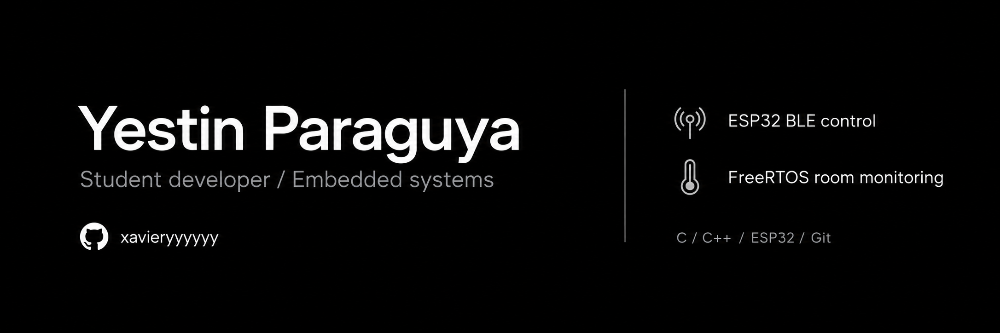
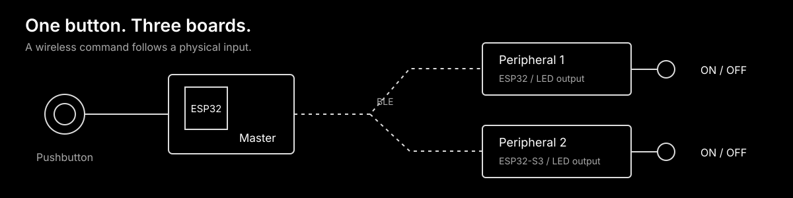
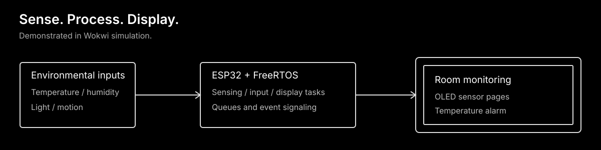
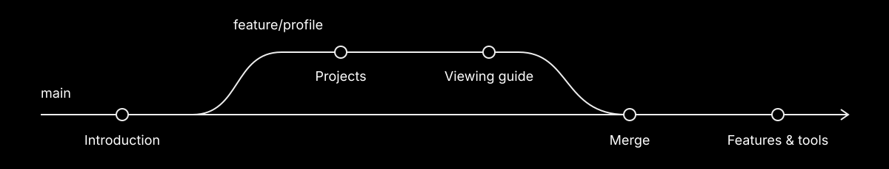

  

  
  
  
  
  

  <a href="#selected-projects">Projects</a> &nbsp; / &nbsp;
  <a href="#versioned-with-git">Git workflow</a> &nbsp; / &nbsp;
  <a href="#view-this-portfolio">Viewing guide</a>

I'm Yestin, a student learning IoT, embedded systems, and firmware.
I use ESP32 projects to practise working with sensors, wireless communication,
and FreeRTOS. Here I share the code, wiring, and demonstrations, along with
the Git workflow I used to build this portfolio.

## Selected projects

###  ESP32 Master-Slave BLE

**One pushbutton controls LEDs on two other boards over Bluetooth Low Energy.**

My individual build includes firmware, wiring, and recorded hardware demonstrations.

- Hold the Master's button to send `ON`; release it to send `OFF`.
- Separate FreeRTOS workers handle commands for each peripheral.
- Hardware recordings and Serial Monitor logs show the individual build in action.

`ESP32` &nbsp; `BLE / GATT` &nbsp; `FreeRTOS` &nbsp; `C++`

[Source & wiring](https://github.com/xavieryyyyyy/esp32_master-slave-ble_comm) &nbsp; / &nbsp;
[Hardware & serial demonstrations](https://github.com/xavieryyyyyy/esp32_master-slave-ble_comm#demonstrations)

> The original Master is the hardware-tested reference. The modular Master still needs separate build and hardware verification.

###  Real-Time Room Monitoring

**Sensor readings, an OLED display, and a temperature alarm, managed with FreeRTOS.**

The project separates sensing, user input, display updates, and alarms into
FreeRTOS tasks. Its demonstration runs in Wokwi.

- Read temperature, humidity, light, and motion inputs.
- View sensor pages on the OLED and change pages with a rotary encoder.
- Trigger a buzzer when temperature goes outside the configured limits.

`ESP32` &nbsp; `ESP-IDF` &nbsp; `FreeRTOS` &nbsp; `Wokwi`

[Source & documentation](https://github.com/xavieryyyyyy/esp32-freertos-room-monitoring-system) &nbsp; / &nbsp;
[Watch the simulation](https://youtu.be/mw-oIcxFS5U)

> The linked recording demonstrates the system in simulation; it is not a physical hardware test.

##  Versioned with Git

I reviewed changes with `git diff`, selected them with `git add`, and saved each
improvement with `git commit`. The project descriptions and viewing instructions
were added on `feature/profile`, merged into `main`, and pushed to GitHub.

| Commit | What changed |
| :--- | :--- |
| `60073d5` | Added my personal introduction |
| `978b5fe` | Featured the BLE and room-monitoring projects |
| `d3601b0` | Added the status badge and viewing instructions |
| `4bb80ac` | Merged `feature/profile` into `main` |
| `7919124` | Explained portfolio features and tools |

[Explore the commit history](https://github.com/xavieryyyyyy/paraguya_github_masterclass/commits/main)

## What I'm learning

- How sensor readings move through firmware to a display or output
- How BLE devices exchange commands and FreeRTOS tasks share work
- How staging, commits, branches, and merges fit into a Git workflow

## Portfolio features

- Two featured ESP32 projects with short explanations
- Links to source code, wiring, and demonstrations
- Instructions for viewing the portfolio on GitHub or in VS Code

## Tools used

| Tool | Role in this portfolio |
| :--- | :--- |
| Markdown | Readable descriptions and links |
| Git | Commits, feature branches, and merging |
| GitHub | Hosting and sharing |
| Shields.io | Monochrome technology and status badges |
| Lucide | Line icons included as SVG images |

##  View this portfolio

Open either project above for its code, wiring, and demonstrations.
You can read this portfolio directly on GitHub without installing anything.

In VS Code, open `README.md` and press **Ctrl+Shift+V** to preview it.

---

[Yestin Paraguya](https://github.com/xavieryyyyyy) / Icons by [Lucide](https://lucide.dev/) ([ISC license](assets/icons/LICENSE)).
